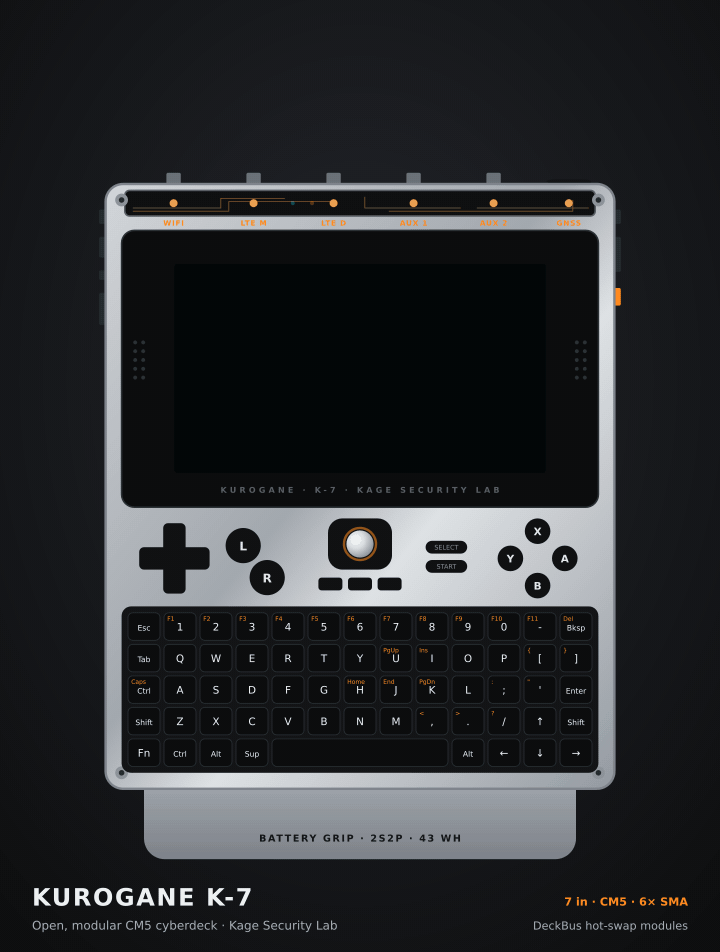
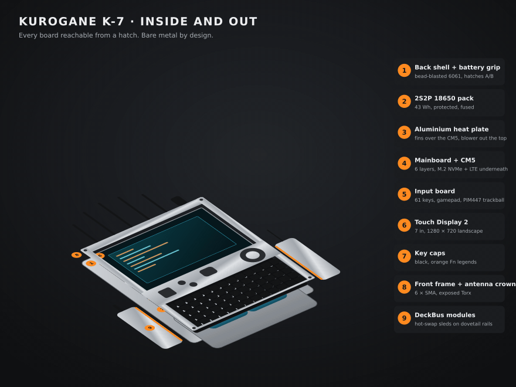

<p align="center">
  
</p>

# Kurogane K-7

*黒鉄, "black iron". An open-hardware project by **Kage Security Lab**.*

**An open, modular CM5 cyberdeck.** A uConsole-style handheld Linux terminal built around a
Raspberry Pi Compute Module 5 on a custom carrier board: 7-inch touchscreen, gamepad strip,
61-key keyboard with trackball, six SMA antenna ports, two hot-swap side-module bays, and a
2S2P battery grip, in a bare-metal aluminium shell.

> **Status: rev A concept.** Nothing has been fabricated yet. The KiCad and OpenSCAD files are
> starting points. Expect changes.

| | |
|---|---|
| Compute | Raspberry Pi CM5 (CM5108032: 8 GB RAM, 32 GB eMMC, Wi-Fi/BT) |
| Display | Raspberry Pi Touch Display 2, 7 in, 1280 × 720 landscape, capacitive touch |
| Input | 61-key keyboard, D-pad, L/R, ABXY, Select/Start, PIM447 trackball, RP2040 + QMK |
| Storage / radio | M.2 M-key NVMe, M.2 B-key LTE/5G + nano-SIM, CM5 Wi-Fi 5 / BT 5 |
| Expansion | 2 × DeckBus v1 side bays (USB 2, I2C, UART, GPIO, power), internal 40-pin HAT bay |
| Antennas | 6 × SMA on the top edge: Wi-Fi, LTE main, LTE div, 2 × aux, GNSS |
| Ports | USB-C PD charge/flash, USB-C 3.0, 2 × USB-A 3.0, HDMI, Gigabit Ethernet, 3.5 mm headset |
| Power | 2S2P 18650 (43 Wh), BQ25792 buck-boost charger, LTC2944 fuel gauge, ~3–5 h runtime |
| Size | 212 × 252 × 34 mm core + 30 mm battery grip; 280 mm wide with both modules |

## Repository layout

```
.
├── docs/
│   ├── BUILD_PLAN.md          full plan: architecture, power, PCB rules, build phases, risks
│   ├── deckbus_v1.md          side-module interface spec (pinout, power, ID EEPROM, hot-plug)
│   └── cm5_signal_map.csv     where every CM5 interface goes
├── bom/BOM.csv                bill of materials (~$1,205 first build, mostly estimates)
├── hardware/
│   ├── mainboard/             KiCad 8: CM5 carrier, 6-layer, 190 × 105 mm
│   ├── keyboard/              KiCad 8: RP2040 input board, 196 × 112 mm + key_positions.csv
│   └── deckbus_module/        KiCad 8: module template, 28 × 100 mm, contact pads placed
├── enclosure/kurogane_k7.scad      parametric OpenSCAD shell, module sled, bay cover
├── software/
│   ├── config.txt.example     boot config starting point
│   └── deckbusd/deckbusd.py   module detector service (skeleton)
├── images/                    product images
└── tools/gen_kicad.py         regenerates the KiCad skeletons from parameters
```

## Getting started

1. Read [`docs/BUILD_PLAN.md`](docs/BUILD_PLAN.md), especially *Build phases*.
2. **Phase 0:** bring everything up on an official CM5 IO Board before ordering any PCB.
3. Download the official **CM5 IO Board KiCad files** (pip.raspberrypi.com, *Design files*) and copy
   the CM5 connector footprints and the USB 3 / PCIe / MIPI routing into `hardware/mainboard`.
4. Open the `.kicad_pro` files in KiCad 8 or 9. Schematic sheets hold notes on what goes where;
   PCBs hold outlines, mounting holes and placement zones.
5. Measure your display and connectors, update the `CHECK` values in `enclosure/kurogane_k7.scad`, then:
   ```
   openscad -o front.stl -D 'part="front"' enclosure/kurogane_k7.scad
   openscad -o back.stl  -D 'part="back"'  enclosure/kurogane_k7.scad
   ```

> `tools/gen_kicad.py` **overwrites** the KiCad files. Run it only before you start drawing.

## Inside and out

<p align="center">
  
</p>

## DeckBus modules

Anyone can build a module: copy `hardware/deckbus_module`, follow [`docs/deckbus_v1.md`](docs/deckbus_v1.md),
program the ID EEPROM, and open a *Module proposal* issue. Planned: GNSS, LoRa/Meshtastic, RTL-SDR,
extra battery, Wi-Fi audit, solar/DC input.

## Contributing

Issues and pull requests welcome; see [CONTRIBUTING.md](CONTRIBUTING.md).

## License

Hardware under CERN-OHL-S-2.0, software under MIT, docs and images under CC BY-SA 4.0.
See [LICENSE.md](LICENSE.md).

## Credits and inspiration

ClockworkPi uConsole, Waveshare PocketTerm35, Flipper One, the DFCD cyberdeck, and the Raspberry Pi
CM5 IO Board reference design.
