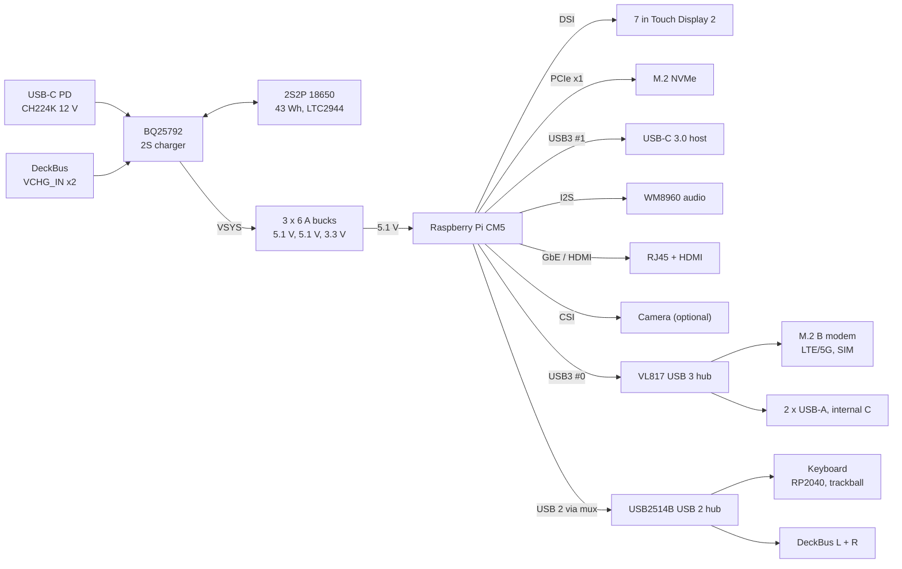

# Kurogane K-7 — Modular Build Plan

Snapshot of the living build plan, exported 2026-11-20. Live version:
https://claude.ai/artifact/Lcem7ovWy82eThDXrzkpSc

## Concept and key specs

Build a uConsole-style slab around a Raspberry Pi CM5 on your own carrier board, with a 7-inch screen and two hot-swappable side module bays. Name: **Kurogane K-7** (黒鉄, "black iron"; 7-inch), by Kage Security Lab. It borrows the uConsole's one-piece slab and the DFCD's idea of a core that accepts modules on rails, then adds standard M.2 slots, an internal HAT header and an antenna panel.

| Item | Choice | Why |
| --- | --- | --- |
| Compute | [Raspberry Pi CM5](https://pip-assets.raspberrypi.com/categories/944-raspberry-pi-compute-module-5/documents/RP-008181-DS-10-cm5-product-brief.pdf), CM5108032 (8 GB RAM, 32 GB eMMC, Wi-Fi/BT) | Pi 5 performance on a 55 × 40 mm module; production until at least Jan 2036; swappable later for 16 GB or Lite |
| Screen | [Raspberry Pi Touch Display 2](https://raspberrypi.com/products/touch-display-2), 7 in, 720 × 1280 DSI, run in landscape | Mainline driver support, 5-point capacitive touch, $60 list, in production until at least Jan 2030 |
| Input | uConsole-style input board: 61-key compact keyboard (5 rows, low-profile tactile switches, printed caps with orange Fn legends) + gamepad strip (D-pad, L/R, Select/Start, ABXY) + Pimoroni PIM447 trackball with 3 mouse buttons, all on one RP2040 running QMK | Own design, firmware-remappable, USB to the mainboard |
| Storage | Internal M.2 M-key 2230/2242 NVMe on the CM5's PCIe Gen 2 x1 lane | 5–10× faster than eMMC/SD |
| Cellular | Internal M.2 B-key 3042/3052 + nano-SIM | Drop-in LTE/5G modems (USB3 type) |
| Expansion | 2 × **DeckBus** side bays (rails + 20-pin pogo), 1 × internal 40-pin HAT header | Swap GPS, LoRa, SDR, extra battery, sensor modules without opening the case |
| Antennas | 6 × SMA bulkheads on the top edge: Wi-Fi, LTE main, LTE div, 2 × aux, GNSS puck | Upgradeable external antennas |
| Battery | 2S2P 18650 (7.2 V nominal, about 43 Wh) | Lower current than 1S boost designs, the CM5 power issue uConsole owners hit |
| Charging | USB-C PD (9–12 V) in, 2S buck-boost charger | Fast charge, charges from any USB-C supply |
| Size target | Core 212 × 252 × 34 mm plus a 30 mm battery grip; 280 mm wide with both side modules; roughly 1.1–1.3 kg | A 'uConsole XL'; parametric, so you can shrink it |

Design rules carried through the whole plan: every high-wear or fast-moving part (CM5, modem, SSD, keyboard, battery, antennas, side modules) is socketed or screwed, never soldered to the mainboard; and every module talks over plain USB, I2C or UART so it works with stock Linux drivers.

## System architecture

The CM5 has exactly one PCIe lane, two USB 3 ports and one USB 2 port, so the design spends them deliberately: PCIe on storage, one USB 3 port fanned out by a hub to the modem and USB-A ports, the other USB 3 straight to a fast USB-C port, and USB 2 through a hub to the keyboard and both DeckBus bays.

Read it left to right: power is generated on the left, fixed built-in I/O hangs off the CM5, and everything you can swap or add sits behind the two hubs. Full pin-level allocation is in the PCB set section and `docs/cm5_signal_map.csv`.

## DeckBus module standard (v1)

Each side of the lower body carries two dovetail rails, 110 mm long, with a 2 × 10 pogo-pin block between them. A module is a 34 × 110 × 30 mm 3D-printed side grip carrying a 28 × 100 mm 2-layer PCB whose inner face has 20 flat gold pads. It slides in, the pogo pins land on the pads, and a spring catch plus an M3 thumbscrew hold it. The module's outer face is free for its own SMA, USB or controls. Full spec: `docs/deckbus_v1.md`.

**Pinout** (deck side = pogo pins, Mill-Max 0906-style, 2.54 mm pitch; module side = ENIG pads, 1.8 mm square):

| Pin | Signal | Pin | Signal |
| --- | --- | --- | --- |
| 1 | GND | 2 | GND |
| 3 | VSYS out (6.0–8.4 V, eFuse 2 A) | 4 | VSYS out |
| 5 | +5V out (load switch, 2 A) | 6 | +5V out |
| 7 | +3V3 out (300 mA) | 8 | GND |
| 9 | USB2 D+ | 10 | USB2 D− |
| 11 | GND | 12 | I2C SDA (per-bay channel of a PCA9546 mux) |
| 13 | I2C SCL | 14 | UART TX (CM5 → module) |
| 15 | UART RX | 16 | GPIO A (PWM-capable) |
| 17 | GPIO B / IRQ | 18 | MOD_DET# (module ties to GND) |
| 19 | VCHG_IN (module → charger input 2, 5–12 V) | 20 | GND |

**Rules every module follows**

- Carry a 24C32 ID EEPROM at I2C 0x50 holding vendor, product, version and a device-tree overlay name, like a Pi HAT. A small `deckbusd` service reads it on insert and loads the overlay.
- Power stays off until MOD_DET# has been low for 200 ms; the eFuse and load switch then ramp VSYS and 5 V. This makes slide-in hot-plug safe.
- Data is USB 2.0 (480 Mb/s), I2C at 100 kHz, or 3.3 V UART. Nothing on the bus is 5 V logic.
- Battery modules feed VCHG_IN, which goes to the charger's second input (VAC2), never straight onto VSYS. The charger then decides who supplies the system.
- Antenna-carrying modules bring their own SMA bulkhead on the outer face.

**Starter module list**

| Module | Inside | Bus |
| --- | --- | --- |
| GNSS | u-blox MAX-M10S + SMA | UART + PPS on GPIO B |
| LoRa / Meshtastic | SX1262 + ESP32-S3, SMA | USB |
| SDR | RTL-SDR v4 board (or a HackRF via cable) | USB |
| Extra battery | 2S1P 18650 + protection BMS | VCHG_IN |
| Wi-Fi audit | USB Wi-Fi chipset + 2 × SMA | USB |
| Hardware hacking | RP2040 debug probe + logic header | USB |
| Solar / DC in | 12 V input + MPPT front end | VCHG_IN |
| Blank sled | Prototyping PCB + EEPROM | any |

## Power system

A 2-cell (2S) pack feeding a TI BQ25792 buck-boost charger, then three 6 A bucks, gives the CM5 its full 5 V / 5 A without the boost-converter brownouts seen on 1S handhelds. uConsole owners running CM5 report shutdowns under load because its AXP228 PMIC is a 1S tablet part ([ClockworkPi forum](https://forum.clockworkpi.com/t/fixing-uconsole-power-delivery-limitations-with-cm5/19119/7)); a 2S pack at 7.2 V draws about half the battery current for the same watts.

**Power tree**

1. **USB-C charge port** (front-left): CH224K PD sink requests 12 V (falls back to 9 V, then 5 V) → BQ25792 input 1 (VAC1). The same port's USB 2.0 pair goes to a TS3USB221 mux so it doubles as the rpiboot flashing port when the BOOT switch is on.
2. **DeckBus VCHG_IN** from both bays → two LM66100 ideal diodes → BQ25792 input 2 (VAC2). Battery and solar modules charge the deck or run it.
3. **[BQ25792](https://ti.com/lit/gpn/BQ25792)**: 1–4 cell buck-boost charger, 5 A charge current, integrated 16-bit ADC, dual-input selector, NVDC power path. Set to 2S, 8.4 V, 3 A charge. Its SYS output (about 6.4–8.4 V) is **VSYS**.
4. **Buck A**, TPS566238 → 5.1 V / 6 A → CM5 VIN and display.
5. **Buck B**, TPS566238 → 5.1 V / 6 A → USB VBUS (per-port current-limit switches), DeckBus 5 V (TPS22965 load switches), keyboard.
6. **Buck C**, TPS566238 → 3.3 V / 6 A → M.2 B-key modem (peaks near 2.5 A), M.2 NVMe, WM8960 codec, DeckBus 3V3.
7. **DeckBus VSYS** → one TPS25947 eFuse per bay (2 A limit, enabled by MOD_DET#).

**Battery pack**: 2S2P of 3000 mAh, 15 A-class 18650s (Molicel P30B or Samsung 30Q from a reputable seller), on its own small pack PCB with an ABLIC S-8252 2-series protection IC, dual N-MOSFET, BQ29209 cell balancer, 10 A fuse and a 10 k NTC to the charger's TS pin. Pack energy: 7.2 V × 6 Ah = 43 Wh.

**Fuel gauge**: an ADI [LTC2944](https://www.analog.com/en/products/ltc2943.html) coulomb counter on a 10 mΩ high-side shunt in the battery lead (the LTC2943 is no longer recommended for new designs). Linux's `ltc2941-battery-gauge` driver exposes it as a normal battery, so the desktop battery icon works.

**Runtime estimate**: the CM5 draws about 6–8 W in a uConsole and about 11 W in bursts ([measurements](https://fubsypoly-hacking.pages.dev/clockwork-uconsole/vol-11/)); add 2–3 W for the 7-inch panel. At 90% conversion efficiency, 43 Wh gives roughly 3.2 h at 12 W and 4.9 h at 8 W. An extra-battery module adds about 21 Wh per bay.

**On/off**: the power key on the keyboard goes to CM5 PWR_BUT (short press = on / clean shutdown). A recessed slide switch drives Buck A's EN as a hard kill. For shipping and storage, BQ25792 ship mode disconnects the pack (about 0.6 µA).

## PCB set

Six boards, each replaceable on its own. Only the mainboard is hard; start every high-speed section by copying the Raspberry Pi [CM5 IO Board KiCad reference](https://pip.raspberrypi.com/categories/1098-design-files) (KiCad 8, open design files) rather than drawing it fresh.

| Board | Size (mm) | Layers | Assembly | Notes |
| --- | --- | --- | --- | --- |
| Mainboard (DM-MB) | 190 × 105 | 6, impedance controlled | JLCPCB PCBA, both sides | CM5 sockets, power, hubs, M.2 × 2, codec, DSI/CSI, Ethernet, HDMI |
| Input board (DM-KB) | 196 × 112 | 2 | PCBA for RP2040 side; hand-solder switches | 61 keys + 16 buttons + trackball + 3 mouse buttons + power key, 6 × 13 matrix |
| Antenna / top-IO (DM-IO) | 180 × 22 | 2 | Hand | SMA bulkhead holder, status LEDs, fan header passthrough |
| Bay pogo board × 2 (DM-PG) | 14 × 38 | 2 | Hand | 2 × 10 spring pins, TVS, FPC to mainboard |
| Battery pack (DM-BP) | 135 × 12 | 2, 2 oz copper | PCBA | S-8252 + BQ29209, fuse, NTC, 6-pin power connector |
| DeckBus module template (DM-MOD) | 28 × 100 | 2 | Hand | ENIG contact pads, ID EEPROM, payload area |

**Mainboard stackup** (JLCPCB JLC06161H-2116 or similar): L1 signal (diff pairs) / L2 GND / L3 power + slow signals / L4 power / L5 GND / L6 signal. Order the impedance-control option.

**CM5 connectors**: two 100-pin 0.4 mm receptacles, Hirose [DF40HC(3.0)-100DS-0.4V(51)](https://www.digikey.com.mx/en/products/detail/hirose-electric-co-ltd/DF40HC-3-0-100DS-0-4V-51/4282911) (3.0 mm mated height), or the Amphenol 10164227-1004A1RLF the CM5 IO board uses. Have JLCPCB place them; do not hand-solder 0.4 mm pitch on a first board.

**Signal allocation**

| CM5 interface | Goes to |
| --- | --- |
| PCIe Gen 2 x1 | M.2 M-key 2230/2242 NVMe |
| USB 3.0 port 0 | VL817 4-port USB 3 hub → M.2 B-key modem, rear USB-A, left USB-A, internal USB-C (HAT bay) |
| USB 3.0 port 1 | Right-side USB-C host port (5 Gb/s, 1.5 A VBUS) |
| USB 2.0 | TS3USB221 mux → (a) USB2514B 4-port hub → keyboard, DeckBus L, DeckBus R, internal header; or (b) charge-port USB-C for rpiboot |
| MIPI 1 (4-lane) | DSI 22-pin 0.5 mm FPC → Touch Display 2 |
| MIPI 0 (4-lane) | CSI 22-pin FPC → optional camera |
| HDMI 0 | Full-size HDMI (ESD + 5 V/55 mA per HDMI spec) |
| Gigabit Ethernet | RJ45 with integrated magnetics |
| GPIO 18–21 (I2S) | WM8960 codec → 2 × 1 W speakers, 3.5 mm headset jack, mic |
| GPIO 2/3 (I2C1) | BQ25792, LTC2944, PCA9546 → DeckBus ID/I2C per bay |
| UART2 / UART3 | DeckBus L / R UART |
| 40-pin header | Internal HAT bay (behind the rear hatch) |
| Fan PWM/tach, RTC VBAT | 30 mm blower header, ML2032 rechargeable coin cell |
| Wi-Fi antenna | CM5 U.FL → SMA pigtail → top antenna panel |

**Routing rules (the things that kill first spins)**

- USB 3 and PCIe pairs: 90 Ω differential (USB) / 85–100 Ω (PCIe per CM5 datasheet), length-matched within a pair to about 0.1 mm, solid GND reference, no layer change without a GND stitching via beside each signal via, AC caps on TX close to the CM5.
- MIPI DSI/CSI: 100 Ω differential, match lanes to the clock pair.
- Keep the three bucks' switching loops on L1 with GND on L2 directly under; inductors away from the DSI FPC and the antenna U.FL.
- Put test points on VSYS, 5V_A, 5V_B, 3V3, PG pins, I2C1 and every USB pair you can spare.
- Add 0 Ω links or solder jumpers so each rail can be brought up one at a time (see Build phases).

## Enclosure and mechanical

The look follows the uConsole: a portrait slab with an antenna crown on top, the 7-inch screen, a gamepad strip, a compact keyboard and a battery grip at the bottom, finished in bare bead-blasted aluminium with exposed screws. The core is 212 × 252 × 34 mm; with a module on each side rail it is 280 mm wide. The screen frame sets the width: the Touch Display 2 measures 189.32 × 120.24 mm overall. For comparison, Waveshare's [PocketTerm35](https://docs.waveshare.com/PocketTerm35) is 93.5 × 168.5 × 37 mm around a 3.5-inch screen. Every dimension below is a parameter in `enclosure/kurogane_k7.scad`; renders are in `mockup/`.

| Zone (front, top to bottom) | Height (mm) | Contents |
| --- | --- | --- |
| Antenna crown | 14 | 6 × SMA bulkheads at 30 mm pitch (Wi-Fi, LTE main, LTE div, aux 1, aux 2, GNSS puck), vents over the blower exhaust |
| Screen | 122 | Touch Display 2 in landscape, 154.6 × 86.9 mm active area, speaker slots either side |
| Gamepad strip | 40 | D-pad, L/R, PIM447 trackball with 3 mouse buttons, Select/Start, ABXY |
| Keyboard | 72 | 61 keys in 5 rows, 13 columns at about 15 mm pitch, orange Fn legends |
| Bottom edge | 4 | Screws, strap points |
| Battery grip (rear, below) | 30 | 180 mm wide bump holding the 2S2P pack |

| Face | Contents |
| --- | --- |
| Left side, upper | USB-C charge + flash port, USB-A 3.0, 3.5 mm headset, RJ45 |
| Right side, upper | USB-C 3.0 host, full-size HDMI, BOOT switch (recessed), hard-kill switch |
| Left / right side, lower | DeckBus rails and pogo block; a 4 mm cover plate when no module is fitted |
| Rear, upper | 6061 aluminium heat plate over the CM5 |
| Rear, middle | Hatch A: M.2 NVMe, M.2 B-key modem, nano-SIM. Hatch B: 40-pin HAT bay (65 × 56 mm, 11 mm stack) |
| Rear, lower | Battery door into the grip, fold-out kickstand |

**Thickness budget**: screen zone = 2 mm front wall + about 10 mm display (measure yours) + 1.6 mm mainboard + 3 mm CM5 connector + 4.7 mm CM5 + 10 mm heatsink/blower + 2 mm back = about 33 mm. Keyboard zone = 6 mm keys + 1.6 mm PCB + about 20 mm free for wiring and speakers + walls = 34 mm. The 18.6 mm cells sit in the rear grip below the keyboard, so the keyboard area stays flat.

**Materials**: prototype in PETG; final shell in bead-blasted 6061 aluminium, or ASA / MJF PA12 nylon if machining is out of reach. The rear upper panel is a 2 mm 6061 plate that doubles as the CM5 heat spreader through a thermal pad. Use heat-set M2.5/M3 brass inserts at every screw boss so the case survives repeated opening.

**Thermal**: the CM5 runs hot and throttles in closed cases, so it gets a low-profile heatsink plus a 30 mm 5 V blower on the CM5 fan header, pulling air in under the screen bezel and out through the top vents beside the SMA row. Keep the battery on the opposite (lower) half from the CM5.

**Antennas**: CM5 Wi-Fi via its U.FL to an SMA pigtail; M.2 modem MAIN and DIV and its GNSS output via U.FL-to-SMA pigtails (150 mm, 1.13 mm coax); two aux SMA ports left for a second Wi-Fi card, an SDR or a HAT, capped until used. Label each port on the shell.

## Software stack

Raspberry Pi OS (64-bit, Bookworm or newer) is the base; Kali ARM64 or DietPi install on the same image layout if you prefer. Everything custom is a device-tree overlay plus a few small services, kept under `software/`.

| Piece | How |
| --- | --- |
| Boot / flashing | `rpiboot` over the charge-port USB-C with BOOT switch on; then boot from NVMe (`BOOT_ORDER=0xf16` in the EEPROM config) |
| Display | Touch Display 2 overlay on the DSI port you wire (check the exact overlay name and `dsi0`/`dsi1` parameter in the Raspberry Pi display docs), rotated to landscape |
| Audio | WM8960 codec overlay on I2S; `alsactl` state file for speaker/headphone switching on jack detect |
| Battery | `lltc,ltc2944` node for the in-kernel `ltc2941-battery-gauge` driver; a Python `deckpower` service talks to the BQ25792 over I2C (charge limits, input source, ship mode), because there is no mainline BQ25792 driver |
| Fan | CM5 fan header with the standard `cooling_fan` thermal trip points tuned for the enclosure |
| Keyboard | QMK on the RP2040: tactile-switch matrix, `pimoroni_trackball` pointing device, layers for F-keys, arrows and media; flash by holding Esc while plugging in (UF2 bootloader) |
| DeckBus | `deckbusd`: watches MOD_DET# GPIOs, reads each bay's EEPROM through the PCA9546, loads the named overlay with `dtoverlay`, logs to the journal |
| Modem | ModemManager + NetworkManager handle the M.2 LTE/5G card; GNSS through `gpsd` |
| Desktop | Wayland (labwc) with a scaling factor around 1.25 for the 1280 × 720 panel; on-screen battery and module status widget |

Keep a `config.txt` and overlay set per hardware revision in git so a new mainboard spin never breaks the old one.

## Build phases

Build it in six phases, each ending in a test gate, so a mistake costs one cheap board instead of the whole deck. Plan on 3–5 months of evenings, most of it waiting on fab and shipping.

1. **Phase 0: bench prototype on the official CM5 IO Board** (2–3 weeks). Buy the CM5, the CM5 IO Board and the Touch Display 2. Bring up the OS, NVMe, display, WM8960 on a breakout, BQ25792 and LTC2944 on eval/breakout boards over I2C, and the PIM447. Measure real current draw at idle, video and full CPU load.
   - Gate: every software piece in the Software stack table works on the IO board; power budget confirmed under 15 W.
2. **Phase 1: power board spin** (3 weeks). A small 2-layer PCB with only the CH224K, BQ25792, three bucks, LTC2944 and the battery connector. Test with a lab supply as a fake battery first, then the real pack, with a fuse in line.
   - Gate: 5.1 V holds within 3% at 5 A load; charge terminates at 8.4 V; ship mode works; no part over 70 °C.
3. **Phase 2: input board** (2 weeks, can run in parallel). Order the 2-layer DM-KB, flash QMK, test every key and the trackball on a PC over USB.
   - Gate: full matrix scan with no ghosting; trackball and power key work.
4. **Phase 3: mainboard rev A** (5–6 weeks). Fork the CM5 IO Board KiCad project, delete what you don't need, merge the proven power board, add hubs, M.2 slots, DeckBus, codec. Run ERC/DRC, check every footprint against its datasheet, order 5 boards with JLCPCB assembly of the CM5 connectors and fine-pitch ICs.
   - Gate (bring-up order): power rails one at a time through the 0 Ω links with a current-limited supply, then CM5 boots to serial console, then display, USB hubs, NVMe, modem, audio, Ethernet, DeckBus.
5. **Phase 4: enclosure** (3–4 weeks, overlaps Phase 3). Print the OpenSCAD shell in PETG, test-fit the display, rev-A board, keyboard and battery; iterate the rails and pogo block with the DM-MOD template board.
   - Gate: closed case runs a 30-minute stress test (`stress-ng --cpu 4`) without throttling below 2.0 GHz; modules slide in and out 50 times without misreads.
6. **Phase 5: first modules and finishing** (ongoing). Build the GNSS and extra-battery modules, label the antenna panel, make the final shell, write the wiring docs.
   - Gate: a full day of field use on battery with one module attached.

Safety throughout: charge new packs on a fireproof surface, never short the pack connector, and keep the pack fuse and NTC from day one.

## Risks

The mainboard is the risk: USB 3, PCIe and MIPI routing around a 0.4 mm CM5 connector is where first spins fail, so copy the CM5 IO Board layout for those sections and budget for a rev B.

| Risk | Mitigation |
| --- | --- |
| High-speed routing errors on rev A | Copy reference routing, impedance-controlled 6-layer, test points, order 5 boards and assemble only 2 |
| CM5 throttling in a closed shell | Heat plate + blower from day one; Phase 4 stress-test gate |
| Battery fire or brownouts | 2S pack with protection IC, balancer, fuse and NTC; reputable cells; staged bring-up on a lab supply |
| Hot-plug damage on DeckBus | MOD_DET# power delay, eFuses, TVS on every pin, no back-feed rule |
| Part prices moving | CM5 list prices rose sharply in 2026; BOM prices marked 'Estimate' need a quote before ordering |
| Display offset and connector heights unknown | Every such value is a CHECK parameter in the OpenSCAD file; measure before printing |
| Software gaps | No mainline BQ25792 driver: plan the `deckpower` service; verify display and codec overlay names on your OS build |

## Sources

[CM5 product brief](https://pip-assets.raspberrypi.com/categories/944-raspberry-pi-compute-module-5/documents/RP-008181-DS-10-cm5-product-brief.pdf) ·
[Touch Display 2](https://raspberrypi.com/products/touch-display-2) ·
[CM5 IO Board design files](https://pip.raspberrypi.com/categories/1098-design-files) ·
[BQ25792](https://ti.com/lit/gpn/BQ25792) ·
[TPS56623x](https://ti.com/lit/pdf/SLUSDQ7) ·
[LTC2943/2944](https://www.analog.com/en/products/ltc2943.html) ·
[PIM447](https://www.robotshop.com/products/pimoroni-trackball-breakout) ·
[Vapor95 cyberdeck guide](https://vapor95.com/blogs/darknet/how-to-build-a-cyberdeck-the-complete-2026-guide-parts-software-and-iconic-builds) ·
[DFCD cyberdeck](https://github.com/ArcticEnrichmentCenter/DFCD-cyberdeck-files) ·
[PocketTerm35](https://docs.waveshare.com/PocketTerm35) ·
[Flipper One](https://flipper.net/pages/flipper-one)
